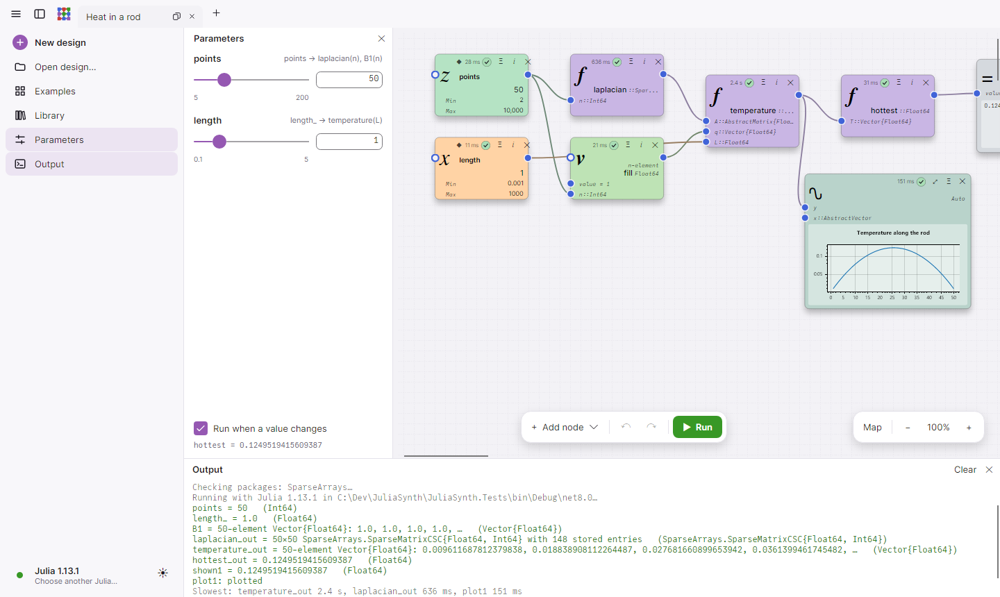
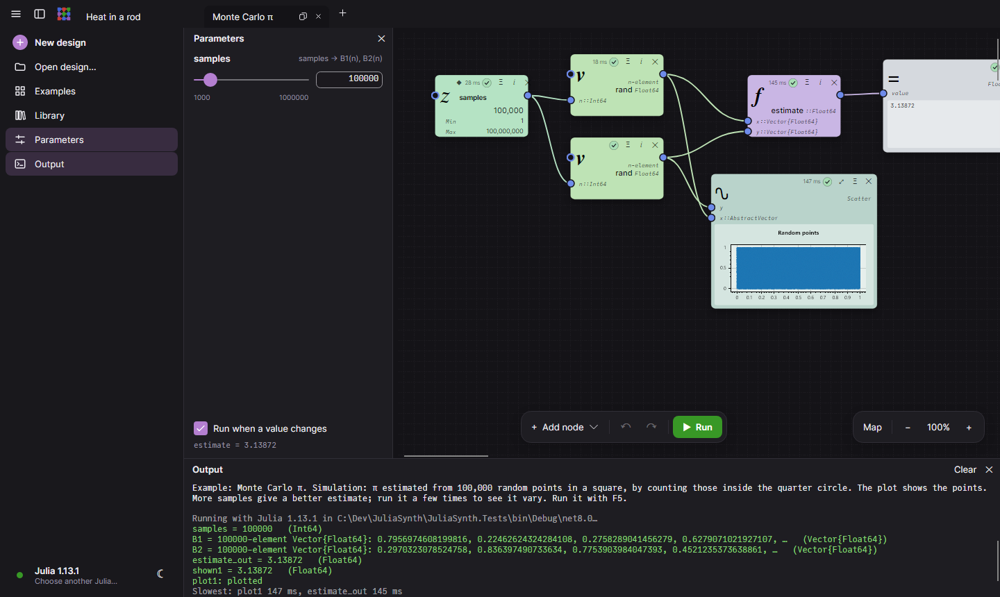

# JuliaSynth

A visual editor for [Julia](https://julialang.org/). Wire inputs, functions and plots together on a canvas, run the design with Julia, and see every value on its node. Any design can be exported as a plain Julia script.

JuliaSynth runs on Windows and Linux, including WSL.



## What it does

A design is a graph of nodes:

- **Inputs:** numbers, vectors, matrices, sparse matrices, arrays built with `zeros`, `rand`, `range` and friends, and arrays loaded from CSV, Matrix Market (`.mtx`), JLD2 or PNG files.
- **Functions:** Julia code you write, with typed parameters. Each parameter is an input port, and the function's value is its output.
- **Outputs:** Display (a value), Plot (line, scatter or heatmap) and Save to file.

Wiring an output into an input passes the value along. Press **F5**, and JuliaSynth turns the design into a Julia script and runs it in a Julia session it keeps open. Each node then shows its value, a ✓ or ✗ badge and how long it took. The output panel lists every value by its variable name.

Designs can also work through data as it comes:

- **Files in a folder:** all the files at once, or one at a time, as a loop.
- **Watch folder:** new files as they arrive, or a web address fetched every few seconds.
- **Every:** a tick every few seconds.
- **Button:** a value each time it is pressed.
- **Map, Window, Only when, Zip and Merge:** apply a function to each value, keep the last few, filter, and combine streams.

## Features

- **Parameters panel:** put inputs in it to set them with sliders and boxes. The design runs again a moment after each change.
- **Names:** an input given a name keeps it as its variable in the script (`loan = 250000.0` rather than `x1`), so the output says which value is which.
- **Breakpoints:** pause a run on a wire (F9), optionally on a condition, see the value, then continue (F5) or step to the next value (F10).
- **Frames and groups:** frames are titled boxes around nodes. Groups turn several nodes into one node. Double-click a frame's title to make it a group, and use the group's ⧉ button to open it again.
- **Library:** save nodes and groups under a name, and add copies of them to any design.
- **Tabs:** several designs open at once, each with its own undo history. A tab can open in a window of its own.
- **Packages:** packages a design uses but doesn't have are offered for installation.
- **Arranging:** Ctrl+Shift+A arranges the nodes, keeping each frame's nodes together.
- **Saving:** designs autosave a moment after each change. A design never saved is kept and reopened at the next start.
- **Export:** export the design as a Julia script, or as a PNG image of the canvas.
- **Look:** a light or dark theme, following the system's setting unless one is chosen. The interface uses Julia's colours.



## Examples

**File → Examples** and the start page open these. Examples with large datasets ask before downloading them, and to where.

| Example | What it shows |
|---|---|
| Loan payment | The monthly payment on a loan; sliders for the amount, rate and years |
| Projectile | How far, how high and how long a thrown ball flies |
| Line fit | A least-squares line through test scores against hours studied |
| PageRank | How important four linked web pages are |
| Heat in a rod | Steady temperature along a rod, from a sparse matrix, plotted |
| Monte Carlo π | π from random points in a square |
| Live Monte Carlo π | π refined live, a batch of darts each tick |
| Random walk | A random walk that grows at each press of a button |
| Weather station week | A week of hourly temperatures, a CSV file a day, mapped day by day |
| Network spread | Four small networks as sparse matrices, and how fast things spread on each |
| Savings growth | Savings growing year by year, from a range |
| Radar clutter map | Radar scans from the Boreas dataset, gone through one at a time |
| Live radar | The same scans arriving as a stream, as from the radar itself |
| Bearing wear | A week of vibration from NASA's IMS bearing test rig, with an alarm as a bearing wears |
| Bearing week in parallel | The same week worked through on all of Julia's threads |
| Earthquake detector | A seismometer's recording minute by minute as the 2019 Ridgecrest earthquake struck |
| Earthquake network | Four seismometers in step, and which ones heard the quake |
| Motion in video | What moves in a fixed camera's frames, scored against frames marked by hand |
| Live air traffic | Aircraft over the Netherlands, Belgium and western Germany, live from the OpenSky Network |
| Storm surge | Hurricane Helene's surge along Florida's Gulf coast, from six tide gauges and the storm's track |

## Keyboard shortcuts

| Keys | Does |
|---|---|
| F5 | Run, or continue from a breakpoint |
| Shift+F5 | Stop |
| F9 | Pause on the selected wire |
| F10 | To the wire's next value |
| Ctrl+N / Ctrl+O / Ctrl+S / Ctrl+Shift+S | New, open, save, save as |
| Ctrl+T / Ctrl+W / Ctrl+Tab | New tab, close tab, next tab |
| Ctrl+B | Show or hide the sidebar |
| Ctrl+Z / Ctrl+Y | Undo, redo |
| Ctrl+C / Ctrl+X / Ctrl+V / Ctrl+D | Copy, cut, paste, duplicate |
| Ctrl+Shift+C | Copy the selection as Julia code |
| Ctrl+G / Ctrl+Shift+G | Group the selection, open a group |
| Ctrl+Shift+A | Arrange the nodes |
| Ctrl+A / Delete / Esc | Select all, delete, clear the selection |
| Ctrl+wheel, Ctrl+0 | Zoom, back to 100% |

On the canvas, a drag pans, Ctrl+drag selects with a box, and right-click adds nodes.

## Requirements

- [.NET SDK 9.0.300](https://dotnet.microsoft.com/download) or newer, plus the .NET 8 runtime (the projects target `net8.0`). Older SDKs can't run Avalonia 12's source generators; `global.json` enforces this.
- [Julia](https://julialang.org/downloads/), preferably through juliaup. JuliaSynth looks for it on the `PATH` and in the usual install folders. You can also choose the Julia program from the sidebar, or with Run → Choose Julia….

## Build and run

```sh
dotnet run --project JuliaSynth.Desktop
dotnet test JuliaSynth.Tests
```

Some tests run real Julia, and skip themselves when Julia isn't found. Tests using an example's downloaded data skip themselves when the data isn't there.

Run `dotnet run --project JuliaSynth.Desktop -- --help` for the command-line options:

- Rendering and headless options.
- `--open <file>`: open one design file, alone in the window.
- `--untitled <file> --name <name>`: open a design that was never saved, alone in the window. This is what a tab opened in a new window uses.

Settings, the library and a design never saved are kept in `%AppData%\JuliaSynth` on Windows and `~/.config/JuliaSynth` on Linux.

## Linux and WSL

JuliaSynth runs on Linux, including Ubuntu under WSL 2 with WSLg (Windows 11 shows the window on the Windows desktop).

1. Install the native library Skia needs:

   ```sh
   sudo apt install libfontconfig1
   ```

2. Install .NET. Ubuntu 22.04's apt only offers SDK 8, which is too old, so use Microsoft's install script:

   ```sh
   curl -sSL https://dot.net/v1/dotnet-install.sh -o dotnet-install.sh
   bash dotnet-install.sh --channel 9.0 --install-dir ~/.dotnet
   bash dotnet-install.sh --channel 8.0 --runtime dotnet --install-dir ~/.dotnet
   export PATH=~/.dotnet:$PATH DOTNET_ROOT=~/.dotnet
   ```

3. Install Julia with `curl -fsSL https://install.julialang.org | sh`.

Under WSL, clone the repository into the Linux file system (for example `~/JuliaSynth`) rather than building from `/mnt/c`, so Linux and Windows builds don't share `bin` and `obj` folders.

Alternatively, publish a self-contained build from Windows and run it in WSL with only `libfontconfig1` installed:

```sh
dotnet publish JuliaSynth.Desktop -c Release -r linux-x64 --self-contained -o publish/linux-x64
```

### Troubleshooting

- **The window has a taskbar icon but nothing shows, and its title starts with `[WARN:COPY MODE]`.** WSLg couldn't set up the shared memory it uses to send windows to Windows; `/mnt/wslg/weston.log` shows `rdp_allocate_shared_memory: Failed to open ...`. This affects every Linux app, not only JuliaSynth. Restart WSL from Windows with `wsl --shutdown` (this stops all running distros), then start JuliaSynth again.
- **The app exits at startup with `Unable to load shared library 'libSkiaSharp'`.** Install `libfontconfig1` (step 1 above).
- **The build fails with `The name 'InitializeComponent' does not exist`.** The .NET SDK is older than 9.0.300; check with `dotnet --version` and install a newer one (step 2 above).

## Project layout

| Folder | Holds |
|---|---|
| `JuliaSynth` | The app: the node model and script generator (`Model`), view models and the examples (`ViewModels`), views and styles (`Views`, `Controls`, `Styles`), fonts and icons (`Assets`) |
| `JuliaSynth.Runtime` | The Julia side: finding Julia, the session that runs scripts, and the reports of values |
| `JuliaSynth.Desktop` | The program: command-line options and platform setup |
| `JuliaSynth.Tests` | xUnit tests, run headless with Avalonia's headless platform |

It is built with [Avalonia](https://avaloniaui.net/) 12, [ReactiveUI](https://www.reactiveui.net/), [AvaloniaEdit](https://github.com/AvaloniaUI/AvaloniaEdit) for the code editor, and [ScottPlot](https://scottplot.net/) for plots.

## Credits

Fonts, all under the SIL Open Font License:

- [Inter](https://rsms.me/inter/) for the interface.
- [JuliaMono](https://github.com/cormullion/juliamono) for code, values and types.
- [Noto Sans Math](https://fonts.google.com/noto/specimen/Noto+Sans+Math) for the nodes' symbols.

Data the examples download. Each download writes the full attribution next to the files.

- **Radar:** the [Boreas dataset](https://www.boreas.utias.utoronto.ca/), Autonomous Space Robotics Lab, University of Toronto (CC BY 4.0).
- **Bearings:** the IMS bearing data, NSF I/UCR Center for Intelligent Maintenance Systems, University of Cincinnati, from the NASA Prognostics Data Repository.
- **Seismograms:** the Global Seismograph Network (IRIS/IDA) and the Southern California Seismic Network, from the EarthScope Consortium's FDSN web services.
- **Video:** the [CDnet 2014](http://www.changedetection.net/) change detection dataset.
- **Storm surge:** water levels and tide predictions from NOAA CO-OPS, and Hurricane Helene's best track from the National Hurricane Center's HURDAT2 database.
- **Air traffic:** the [OpenSky Network](https://opensky-network.org/) live API.

## License

JuliaSynth is under the [MIT License](LICENSE). The fonts and the example data keep their own licenses, listed above.
